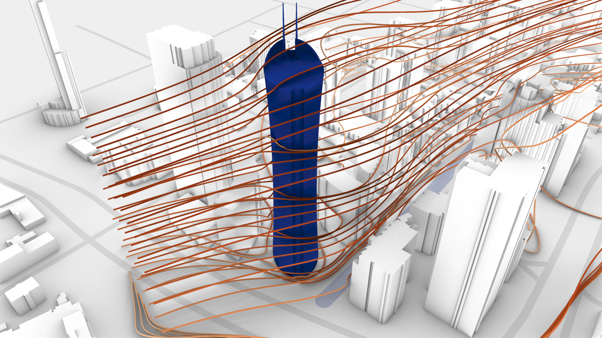
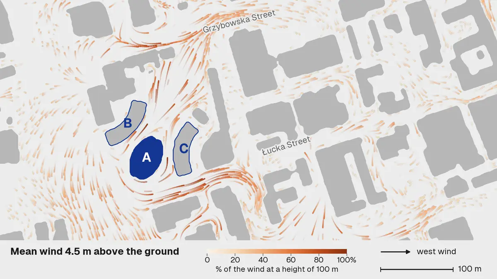
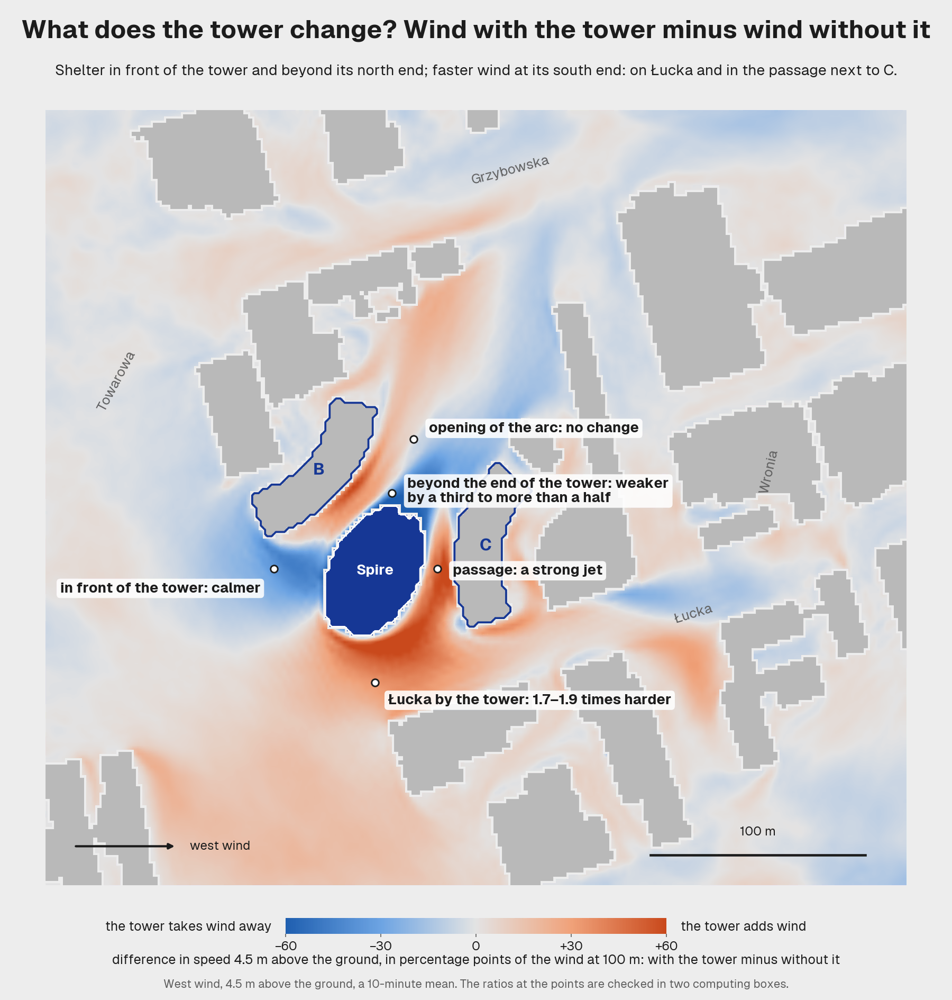
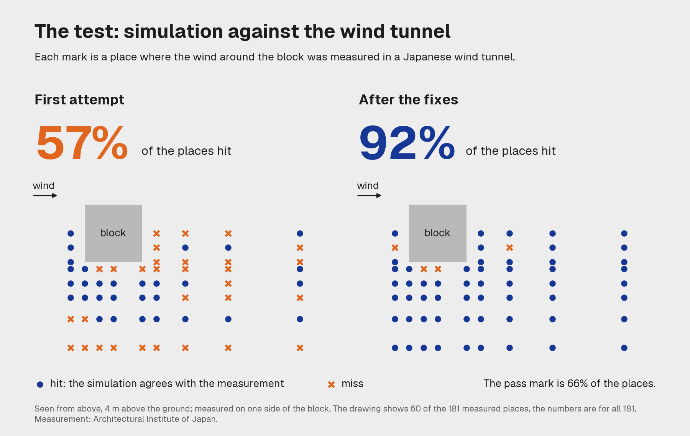

# Wind around Warsaw Spire

The altered FluidX3D solver behind a wind study of the Warsaw Spire tower in Warsaw, with its wind-tunnel validation.



This is an altered copy of [FluidX3D](https://github.com/ProjectPhysX/FluidX3D), the lattice Boltzmann GPU solver by Dr. Moritz Lehmann. The architect [Mateusz Bochyński](https://mateuszbochynski.com/en) used it for a non-commercial experiment published on a personal blog: [Wind around Warsaw Spire](https://mateuszbochynski.com/en/blog/wind-simulation-warsaw-spire), a look at the wind around the Warsaw Spire tower and along Łucka street, computed from a model of the city centre. The code is published because the FluidX3D licence requires it (see [Licence](#licence)).

## What this is and what it is not

- It is the source that computed the published results of the study. One wind setup replaces the upstream examples; a turbulent inflow, a wall-stress condition for the ground and more outputs were added.
- It was checked against a wind-tunnel benchmark, AIJ case A. The single block passes from 24 cells across it; at 16 cells four of five rows are met. A second case, a tower among city blocks, did not pass. Details: [docs/VALIDATION.md](docs/VALIDATION.md).
- It is not the original FluidX3D. It is marked as altered in this file, in [CHANGES.md](CHANGES.md) and in the first line of every altered file.
- The images of the study are illustrations of an experiment, not a wind engineering study. The check supports nothing about gusts, and nothing about wind near the ground in streets and gaps of fewer than about ten to fifteen cells across.

## Results made with this source



| What the tower changes near the ground in a west wind | The wind-tunnel check, before and after the fixes (at 24 cells across the block) |
|---|---|
|  |  |

Buildings: GUGiK LOD1 2024 and NMPT; streets: © OpenStreetMap contributors; wind-tunnel measurement: Architectural Institute of Japan. The images come from the blog post and are not covered by the licence of the code.

The study was computed twice; the earlier version of the setup is described under [History](CHANGES.md#history). Every published result of this version was computed with the wall-model build of this source, on rented NVIDIA GPUs:

- the west-wind runs of five variants of the Warsaw Spire complex on a 2 m grid;
- the year of wind: twelve wind directions on the 2 m grid, with and without the tower, and a repeat of one direction with a 3D box for streamline images;
- the facade close-up on a 1 m grid;
- the wind-tunnel check on AIJ case A at 16, 24 and 32 cells across the building, and the second check on AIJ case D;
- the films of the post, made afterwards from the planes the west-wind run had written.

How that binary was built, and how `src/` differs from the source that was built (in comments only): [CHANGES.md](CHANGES.md#record-of-the-build-that-produced-the-results).

## What is altered

Five files differ from upstream commit `b85d64e` and one file is new. [CHANGES.md](CHANGES.md) describes every change; [changes.patch](changes.patch) is the diff.

| File | Change |
|---|---|
| `src/setup.cpp` | One wind setup replaces the upstream examples: a city height map (and an optional STL) becomes the solid, the wind enters from the west (+x), the mean profile is held on every outer face, a turbulent inflow can be played back at the inlet, and the run writes averaged planes and rendered views. All inputs come from environment variables. |
| `src/kernel.cpp` | A wall-stress condition for the ground, two small kernels (inflow playback, plane recording), the Smagorinsky constant as a define, a single-hue colour scale. |
| `src/lbm.cpp`, `src/lbm.hpp` | Buffers and calls for the new kernels; colour range, Q threshold and Smagorinsky constant read at run time. |
| `src/defines.hpp` | Benchmark off; equilibrium boundaries, LES and off-screen graphics on; frame size and background; two build flags. |
| `build.sh` (new) | Builds without starting the solver. |

Everything else under `src/`, including `src/OpenCL/` and `src/X11/`, is unchanged.

## Build

The code needs a C++17 compiler and OpenCL. `build.sh` compiles `src/*.cpp` into `temp/<variant>/` and links `bin/FluidX3D-wind[-<variant>]`. It never starts the solver.

```
./build.sh                                                     # bin/FluidX3D-wind                   ground as upstream (bounce-back)
./build.sh wall-model -DGROUND_WALL_MODEL                      # bin/FluidX3D-wind-wall-model        wall-stress ground: the build of the published results
./build.sh wall-model-fp32 -DGROUND_WALL_MODEL -DFP32_STORAGE  # bin/FluidX3D-wind-wall-model-fp32   the same with 32-bit storage of the distributions (control runs)
```

The variant only names the binary; the flags decide what is built.

- macOS: the Xcode command line tools (`g++` is clang). The script links `-framework OpenCL`. No X11 is needed.
- Linux: `g++`. The script links `-lOpenCL` and adds the bundled `src/OpenCL/lib` to the linker path, so linking needs nothing else. To run, the machine needs the vendor's OpenCL driver (ICD). If the linker does not accept the bundled library, install `ocl-icd-opencl-dev`.
- Windows: not tried. The upstream repository has the Visual Studio project.

Do not rebuild a variant while a run uses its binary, and do not run two builds of one variant at once: they share `temp/<variant>/`.

## A minimal run

The solver reads everything from environment variables. This example makes the block of the wind-tunnel check at 16 cells across its width (a domain of 496 x 352 x 185 cells of 2 m) and runs 60 s of wind with a power-law inflow. The second 30 s are averaged. It needs Python 3 with numpy (here through [uv](https://docs.astral.sh/uv/)) and a GPU with OpenCL.

```
cd validation
uv run --with numpy python -I scripts/make_block_geometry.py 16 inputs/block-16-cells
(cd .. && ./build.sh wall-model -DGROUND_WALL_MODEL)
HM=inputs/block-16-cells/height.u16 HX=496 HY=352 NZ=185 DX_M=2 PX=168 PY=176 \
ZREF_M=64 ALPHA=0.173 Z0_M=2.947e-4 T_SI=60 FRAMES=2 RENDER=0 OUT=runs/first-test/ \
../bin/FluidX3D-wind-wall-model
```

`make_block_geometry.py` prints these grid values on its line starting with `ENV:`. The results are raw arrays in `runs/first-test/planes/`. Every variable, the input formats and the outputs: [docs/USAGE.md](docs/USAGE.md). The full settings of the wind-tunnel check are in `validation/run-settings/`.

## Validation and limits

- [docs/VALIDATION.md](docs/VALIDATION.md): the wind-tunnel check, how to repeat it, its results, the second case and the full list of its limits.
- [docs/USAGE.md](docs/USAGE.md#limits-of-the-setup): the limits of the setup itself (boundaries, solids, inflow table, rendered images).

## Repository layout

| Path | Content |
|---|---|
| `src/` | the complete altered FluidX3D source |
| `build.sh` | the build script |
| `changes.patch` | the diff against upstream commit `b85d64e` |
| `CHANGES.md` | every change against upstream, the record of the build and the history |
| `docs/USAGE.md` | environment variables, input formats, outputs, limits of the setup |
| `docs/VALIDATION.md` | the wind-tunnel check |
| `docs/images/` | three images and an animation from the blog post |
| `validation/scripts/` | our scripts of the wind-tunnel check |
| `validation/run-settings/` | the five run settings of the check |
| `validation/inflow-calibration.json` | the calibration of the turbulent inflow |
| `LICENSE.md` | the upstream licence |

## Licence

This is an altered version of FluidX3D by Dr. Moritz Lehmann, https://github.com/ProjectPhysX/FluidX3D, based on commit `b85d64ee39a72687d163d42806c9a0ccdaed6d3c` (v3.8 plus 10 commits). It is not the original software and is marked as altered here, in `CHANGES.md` and in the header line of every altered file (clause 1 of the licence). This repository exists to satisfy clause 5: results generated with an altered version were published, so the altered source is published too.

The use is non-commercial (clause 2): a personal blog, no product, no service, no fee.

`LICENSE.md` is the upstream licence file, unchanged, and applies to this repository (clause 7). The scripts in `validation/` are our own and may be used under the same terms as the rest of the repository.

### References

Clause 6 of the FluidX3D licence asks scientific publications that arise from the software to cite these articles. The blog post is not a scientific publication; the list is copied from the upstream README.

- Lehmann, M.: [Computational study of microplastic transport at the water-air interface with a memory-optimized lattice Boltzmann method](https://doi.org/10.15495/EPub_UBT_00006977). PhD thesis, (2023)
- Lehmann, M.: [Esoteric Pull and Esoteric Push: Two Simple In-Place Streaming Schemes for the Lattice Boltzmann Method on GPUs](https://doi.org/10.3390/computation10060092). Computation, 10, 92, (2022)
- Lehmann, M., Krause, M., Amati, G., Sega, M., Harting, J. and Gekle, S.: [Accuracy and performance of the lattice Boltzmann method with 64-bit, 32-bit, and customized 16-bit number formats](https://www.researchgate.net/publication/362275548_Accuracy_and_performance_of_the_lattice_Boltzmann_method_with_64-bit_32-bit_and_customized_16-bit_number_formats). Phys. Rev. E 106, 015308, (2022)
- Lehmann, M.: [Combined scientific CFD simulation and interactive raytracing with OpenCL](https://www.researchgate.net/publication/360501260_Combined_scientific_CFD_simulation_and_interactive_raytracing_with_OpenCL). IWOCL'22: International Workshop on OpenCL, 3, 1-2, (2022)
- Lehmann, M., Oehlschlägel, L.M., Häusl, F., Held, A. and Gekle, S.: [Ejection of marine microplastics by raindrops: a computational and experimental study](https://doi.org/10.1186/s43591-021-00018-8). Micropl.&Nanopl. 1, 18, (2021)
- Lehmann, M.: [High Performance Free Surface LBM on GPUs](https://doi.org/10.15495/EPub_UBT_00005400). Master's thesis, (2019)
- Lehmann, M. and Gekle, S.: [Analytic Solution to the Piecewise Linear Interface Construction Problem and Its Application in Curvature Calculation for Volume-of-Fluid Simulation Codes](https://doi.org/10.3390/computation10020021). Computation, 10, 21, (2022)

The wind-tunnel benchmark and its data are cited in [docs/VALIDATION.md](docs/VALIDATION.md#references).

## Not included

- The AIJ workbooks (download them from the AIJ page named in [docs/VALIDATION.md](docs/VALIDATION.md#data)).
- The city model: height maps and the tower STL, built from Polish GUGiK elevation data and building footprints, and the inflow tables made for it.
- The scripts that turned the city runs into the published images, and the results (raw arrays, frames, films). The images and the animation in `docs/images/` are taken from the blog post.
